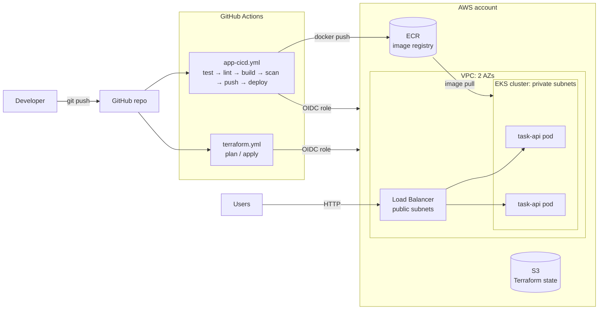

# End-to-End DevOps Capstone: Ship a Node.js API to AWS EKS

You get a working Node.js REST API. Your job is to take it all the way to production:

**Containerize it → provision AWS infrastructure with Terraform → build a CI/CD pipeline with GitHub Actions → deploy it to a Kubernetes (EKS) cluster.**

By the end, every `git push` to `main` will test, build, scan, and deploy your app to a live URL. No one will click anything in the AWS console.

---

## Architecture



## Tools you will use

| Area | Tool |
|---|---|
| Application | Node.js 24, Express, `node:test` |
| Containers | **Docker (you write the Dockerfile)**, hadolint, Trivy |
| Infrastructure as Code | Terraform (S3 remote state, community modules) |
| Cloud | AWS: IAM + OIDC, VPC, NAT Gateway, ECR, EKS, ELB |
| Orchestration | Kubernetes: Namespace, ConfigMap, Deployment, Service, probes, rolling updates |
| CI/CD | GitHub Actions, Environments with approvals, OIDC (no stored AWS keys) |
| Observability | `/healthz`, `/readyz`, Prometheus `/metrics` endpoint |

---

## ⚠️ Cost warning: read this first

EKS is **not** free tier. While the infrastructure is running you pay for roughly:

- EKS control plane: ~$0.10/hour
- 2 × t3.medium nodes: ~$0.08/hour
- NAT Gateway: ~$0.045/hour, plus data
- Load balancer: ~$0.025/hour

That's about **$6–7 per day**. Destroy everything when you finish each working session (see [Teardown](#phase-7--teardown)). Set up an **AWS Budget alert** (for example $20) before you start.

---

## Prerequisites

- AWS account with an IAM user that has admin rights (for the one-time bootstrap)
- GitHub account
- Installed locally: `git`, `node` (22+), `docker`, `terraform` (1.10+), `aws` CLI v2, `kubectl`
- `aws configure` done and `aws sts get-caller-identity` works

## Repository layout

```
.
├── app/                        # Node.js API (given)
│   ├── src/app.js              # routes, metrics
│   ├── src/server.js           # startup + graceful shutdown
│   ├── test/app.test.js        # unit tests
│   ├── package.json / package-lock.json
│   └── Dockerfile              # ← YOU CREATE THIS (plus .dockerignore)
├── terraform/
│   ├── bootstrap/              # one-time: state bucket, GitHub OIDC, IAM roles
│   └── infra/                  # VPC, EKS, ECR (run by the pipeline)
├── k8s/                        # Kubernetes manifests
│   └── optional/hpa.yaml       # stretch goal
└── .github/workflows/
    ├── terraform.yml           # infrastructure pipeline
    └── app-cicd.yml            # application pipeline
```

---

## Phase 1: Run the app locally

```bash
cd app
npm ci
npm test
npm start
```

Try the endpoints:

| Endpoint | Purpose |
|---|---|
| `GET /` | service info, version, and **which pod** answered (hostname) |
| `GET /healthz` | liveness probe |
| `GET /readyz` | readiness probe (returns 503 during shutdown) |
| `GET /metrics` | Prometheus metrics |
| `GET/POST /api/tasks`, `GET/PATCH/DELETE /api/tasks/:id` | Tasks CRUD |

```bash
curl -X POST localhost:3000/api/tasks -H 'Content-Type: application/json' -d '{"title":"Write Dockerfile"}'
curl localhost:3000/api/tasks
```

✅ **Checkpoint:** tests pass and you can create and list tasks.

---

## Phase 2: Containerize the app (your main task) 🐳

Create `app/Dockerfile` and `app/.dockerignore`. The pipeline will **reject** your image if it doesn't meet these requirements, so read them carefully.

### Required

1. **Multi-stage build.** Install dependencies in one stage and copy only what's needed into the final stage.
2. **Small, official base image.** Use `node:24-alpine` or similar. Target final image size: **under 200 MB**.
3. **Production dependencies only.** Use `npm ci` (not `npm install`) and leave out devDependencies.
4. **Layer caching.** Copy `package.json` and `package-lock.json` and install **before** copying the source code. Explain why in your report.
5. **Non-root user.** The Kubernetes Deployment enforces `runAsNonRoot` with UID 1000, and CI checks that `USER` is set.
6. **Port 3000** exposed. The app reads `PORT` from the environment.
7. **Exec-form `CMD`** (`CMD ["node", ...]`) so Node receives `SIGTERM` and shuts down gracefully. Don't use `npm start` as the entrypoint. Explain why in your report.
8. **No write access needed.** The pod runs with a read-only root filesystem.
9. **`.dockerignore`** that keeps `node_modules`, tests, `.git`, and secrets out of the build context.
10. **Passes hadolint** with no warnings: `docker run --rm -i hadolint/hadolint < Dockerfile`

### Bonus

- `HEALTHCHECK` instruction
- Image passes a Trivy scan with zero CRITICAL vulnerabilities: `trivy image task-api:local`

### Test it locally

```bash
cd app
docker build -t task-api:local .
docker images task-api:local                       # check the size
docker run --rm -p 3000:3000 --read-only task-api:local
curl localhost:3000/healthz
docker inspect --format '{{.Config.User}}' task-api:local   # must not be empty or root
```

Then stop the container with `docker stop` and confirm in the logs that you see `SIGTERM received, shutting down gracefully...`.

✅ **Checkpoint:** the image builds, runs read-only as non-root, is under 200 MB, passes hadolint, and shuts down gracefully.

---

## Phase 3: Bootstrap AWS (one time, from your laptop)

The pipelines need somewhere to store Terraform state and a way to log into AWS **without access keys**. GitHub Actions uses **OIDC**: GitHub issues a short-lived token, and AWS trusts it only for *your* repo.

1. Push this project to **your own** GitHub repository.
2. Run the bootstrap stack:

```bash
cd terraform/bootstrap
cp terraform.tfvars.example terraform.tfvars   # set github_owner and github_repo
terraform init
terraform apply
```

3. Note the outputs. You'll need them in the next phase.

> The bootstrap state is stored **locally** in `terraform/bootstrap/terraform.tfstate`. Don't delete it. You'll need it to tear down at the end.

**Questions to answer in your report:**
- What does the `sub` condition in the IAM trust policy protect against?
- Why are there two roles instead of one?

---

## Phase 4: Configure GitHub

In your repo, go to **Settings → Secrets and variables → Actions → Variables** and add these **repository variables**:

| Variable | Value |
|---|---|
| `AWS_REGION` | e.g. `us-east-1` (same as bootstrap) |
| `TF_STATE_BUCKET` | bootstrap output |
| `AWS_TERRAFORM_ROLE_ARN` | bootstrap output |
| `AWS_DEPLOY_ROLE_ARN` | bootstrap output |
| `EKS_CLUSTER_NAME` | `capstone-dev` (`<project>-<environment>`) |
| `ECR_REPOSITORY` | `capstone-dev-task-api` |

Then go to **Settings → Environments** and create:

- `infrastructure` with **Required reviewers** set to yourself (so no apply happens without approval)
- `production` (optionally with required reviewers too)

> No secrets needed: OIDC replaces `AWS_ACCESS_KEY_ID` and `AWS_SECRET_ACCESS_KEY`.

---

## Phase 5: Provision infrastructure with the pipeline

1. Optional: in `terraform/infra/variables.tf`, check `kubernetes_version` against the [EKS supported versions](https://docs.aws.amazon.com/eks/latest/userguide/kubernetes-versions.html).
2. Create a branch, make a small change under `terraform/infra/` (for example, add a tag), and open a **pull request**. Watch `terraform.yml` run `fmt`, `validate`, and `plan`. Read the plan in the job summary.
3. Merge the PR. The **apply** job waits for your approval on the `infrastructure` environment. Approve it.
4. Wait about 15 minutes for EKS to be created.
5. Connect from your laptop. Add your IAM user ARN to `admin_principal_arns` first (via a PR), or use the output command if your user has access:

```bash
aws eks update-kubeconfig --region us-east-1 --name capstone-dev
kubectl get nodes
```

✅ **Checkpoint:** `kubectl get nodes` shows 2 `Ready` nodes, and the ECR repository exists.

**Questions to answer in your report:**
- Why do the worker nodes live in private subnets?
- What do the `kubernetes.io/role/elb` subnet tags do?
- What would happen if two people ran `terraform apply` at the same time? How does this setup prevent it?

---

## Phase 6: Deploy the app with CI/CD

Commit your `Dockerfile` and `.dockerignore` and push to `main`. The `app-cicd.yml` pipeline runs:

```
test ──┐
       ├──► build-push ──► deploy
lint ──┘     (build, smoke test, non-root check,     (kubectl apply, rollout status,
              Trivy scan, push to ECR)               auto-rollback, LB smoke test)
```

On a pull request, only `test` and `lint-docker` run.

Watch the deploy:

```bash
kubectl get all -n task-api
kubectl get svc task-api -n task-api      # EXTERNAL-IP is your app's URL
```

The job summary prints the URL. Open it and refresh a few times. The `hostname` changes because the load balancer spreads traffic across pods.

✅ **Checkpoint:** the app is reachable at the load balancer URL, and `version` shows your commit SHA.

### Exercises

1. **Change and ship.** Change `WELCOME_MESSAGE` in `k8s/01-configmap.yaml` and a response field in `app/src/app.js`. Push, and confirm the new version is live with zero downtime. Run `while true; do curl -s http://<LB>/ | jq .version; sleep 0.5; done` during the deploy.
2. **Break it on purpose.** Change `livenessProbe.path` to `/does-not-exist` and push. Watch the pipeline detect the failed rollout and run `kubectl rollout undo`. Then fix it.
3. **Fail the gate.** Change the `Dockerfile` to run as root, push on a branch, and open a PR. Which job catches it?
4. **Scale.** Run `kubectl scale deploy/task-api -n task-api --replicas=4`, then create a few tasks and list them repeatedly. Why do results differ between requests? How would you fix that?
5. **Self-heal.** Delete a pod with `kubectl delete pod` and watch what Kubernetes does.

---

## Phase 7: Teardown

⚠️ **Order matters.** The load balancer was created by Kubernetes, not Terraform. If you destroy the VPC first, Terraform will hang.

```bash
# 1. Delete the Kubernetes resources (removes the load balancer)
kubectl delete -f k8s/
# wait ~2 minutes for the load balancer to disappear

# 2. Destroy the infrastructure
#    GitHub → Actions → "Terraform (Infrastructure)" → Run workflow → action: destroy → approve

# 3. Only at the very end of the course: destroy the bootstrap
cd terraform/bootstrap && terraform destroy
```

Verify in the AWS console (EC2, Load Balancers, NAT Gateways, EKS) that nothing is left running.

---

## Deliverables

1. **GitHub repo link** with your `Dockerfile`, `.dockerignore`, and a green pipeline history
2. **Screenshots:**
   - successful `terraform plan` on a PR, and the approved apply
   - green `App CI/CD` run with the job summary showing the URL
   - `kubectl get all -n task-api`
   - the app responding in a browser
   - the auto-rollback from Exercise 2
3. **Report (1–2 pages)** answering every **Questions** block above, plus:
   - Explain each line of your Dockerfile and your final image size
   - Describe the full path of a code change from `git push` to running pod
   - One thing you would change before running this in real production
4. **Proof of teardown:** a screenshot of the destroy run

## Grading rubric (100 pts)

| Area | Points |
|---|---|
| Dockerfile meets all 10 requirements | 25 |
| Infrastructure provisioned through the Terraform pipeline (PR plan + approved apply) | 20 |
| App deployed via GitHub Actions and reachable through the load balancer | 20 |
| Exercises 1–5 completed with evidence | 15 |
| Report: correct, clear answers | 15 |
| Clean teardown | 5 |
| **Bonus:** stretch goals | up to +15 |

## Stretch goals

- **Ingress:** install the AWS Load Balancer Controller (via EKS Pod Identity) and replace the `LoadBalancer` Service with an ALB Ingress
- **Autoscaling:** install metrics-server, apply `k8s/optional/hpa.yaml`, and load-test with `hey` or `k6`
- **Helm or Kustomize:** replace the `sed` templating with a Helm chart or Kustomize overlays
- **Least privilege:** replace `AdministratorAccess` on the Terraform role with a scoped policy, add a read-only plan role, and scope the deploy role to the `task-api` namespace
- **Monitoring:** install kube-prometheus-stack and build a Grafana dashboard from `/metrics`
- **Supply chain:** pin GitHub Actions to commit SHAs, sign images with cosign, and add Dependabot
- **GitOps:** replace the `kubectl apply` step with Argo CD watching the `k8s/` folder
- **Multi-environment:** add a `staging` environment that deploys automatically, with `production` requiring approval

## Troubleshooting

| Symptom | Likely cause |
|---|---|
| `Not authorized to perform sts:AssumeRoleWithWebIdentity` | `github_owner`/`github_repo` in bootstrap doesn't match the repo exactly, or the environment name differs from `infrastructure`/`production` |
| `kubectl`: `the server has asked for the client to provide credentials` | Your IAM principal has no EKS access entry. Add it to `admin_principal_arns` |
| Pod `CreateContainerConfigError: container has runAsNonRoot and image will run as root` | Your Dockerfile has no `USER` |
| Pod `CrashLoopBackOff` | `kubectl logs -n task-api <pod>`. Often the wrong `CMD` or files missing from the image |
| `ImagePullBackOff` | Image tag not in ECR. Did `build-push` succeed? |
| `terraform destroy` stuck on subnets or the VPC | The load balancer still exists. Run `kubectl delete -f k8s/` first |
| hadolint `DL3008`/`DL3018` | Pin package versions in `apt-get` or `apk add`, or avoid installing extra packages |
